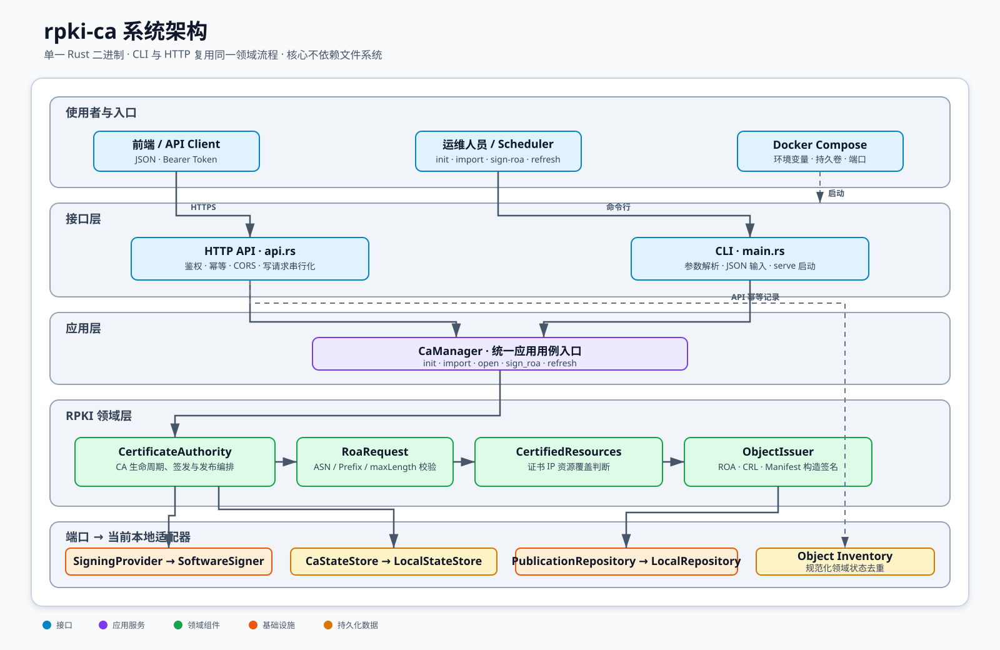
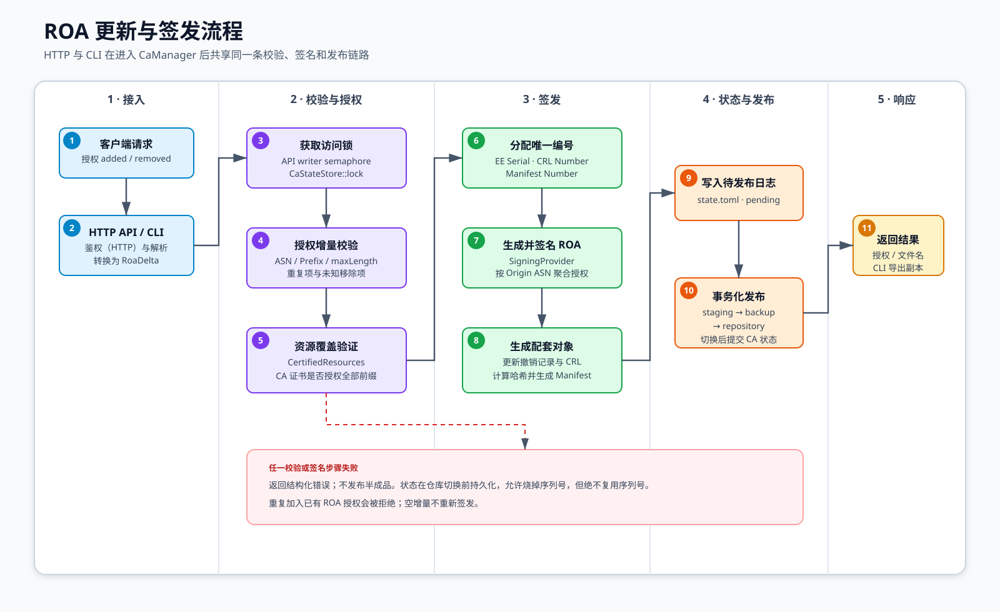

# rpki-ca 系统设计与调用链

本文使用系统设计文档中常见的分层组件图和业务流程图描述当前实现。图片使用 SVG 矢量格式，可以直接浏览、嵌入文档或无损缩放导出。

## 1. 系统架构



架构分为五层：

| 层级 | 组件 | 职责 |
|---|---|---|
| 接口层 | HTTP API、CLI | 接收输入、鉴权、幂等和参数转换 |
| 应用层 | `CaManager` | 为不同入口提供统一应用用例 |
| 领域层 | `CertificateAuthority`、`CertifiedResources`、`ObjectIssuer` | 执行资源验证、对象签发、撤销和发布编排 |
| 端口层 | `SigningProvider`、`CaStateStore`、`PublicationRepository`、`IdempotencyStore` | 定义领域和应用所需能力，不约束存储介质 |
| 基础设施层 | `SoftwareSigner`、`LocalStateStore`、`LocalRepository`、`LocalIdempotencyStore` | 当前本地签名、状态持久化、幂等和事务化发布适配器 |

CLI 和 HTTP API 不各自实现签发逻辑；二者进入 `CaManager` 后共享同一个领域流程。

## 2. ROA 签发调用流程



调用链摘要：

```text
HTTP POST /api/v1/roas 或 CLI sign-roa
└─ RoaRequest::validate
   └─ CaManager::open / sign_roa
      └─ CertificateAuthority::sign_roa
         ├─ StateLock::acquire
         ├─ CertifiedResources::authorizes_roa
         ├─ CaState::allocate_publication
         ├─ ObjectIssuer::issue_roa
         └─ CertificateAuthority::publish
            ├─ ObjectIssuer::issue_crl
            ├─ ObjectIssuer::issue_manifest
            ├─ CaStateStore::save（写入待发布日志）
            ├─ PublicationRepository::publish
            └─ CaStateStore::save（提交日志；启动时可重放）
```

## 3. 其他入口

```text
rpki-ca init
└─ CaManager::init
   └─ CertificateAuthority::init
      ├─ SoftwareSigner::generate
      ├─ write_development_ta_certificate
      └─ refresh_locked → CRL + Manifest

rpki-ca import
└─ CaManager::import
   └─ CertificateAuthority::import
      ├─ inspect_import
      ├─ validate_import_path
      └─ refresh_locked → CRL + Manifest

rpki-ca refresh
└─ CaManager::open
   └─ CertificateAuthority::refresh
      └─ refresh_locked → CRL + Manifest

rpki-ca serve
└─ api::serve
   ├─ POST /api/v1/roas
   ├─ GET /api/v1/roas/{id}
   ├─ GET /repository/{name}
   └─ GET /healthz
```

## 4. 设计边界

源码目录与这些边界直接对应：`api/` 是接口层，`application/` 是应用层，
`domain/` 与 `ca/` 保存领域模型和 CA 核心流程，`infrastructure/` 保存文件系统及
软件签名适配器，`validation/` 负责对发布结果做独立验证。

- 前端只依赖 HTTP DTO，不直接访问私钥、`state.toml` 或发布目录。
- `CaManager` 是 CLI 和 HTTP 的共同入口。
- `CertificateAuthority` 保证资源、序列号、撤销、CRL 和 Manifest 一致性。
- ROA 和 ASPA 先转换为 `ObjectDefinition`，经资源授权后成为 `ValidatedPublication`，签名完成后才记录为 `IssuedObject`；配置意图和已发布事实不会混在同一个类型中。
- 已发布对象按 `ObjectKind + logical_key` 管理。ASPA 的逻辑键为 Customer ASN，因此 Provider 列表更新会稳定替换同一个 ASPA。
- HTTP 创建入口共用 `create_signed_object`，`SigningProvider` 共用 `issue_object`；新增对象类型不需要复制整套 API 和 CA 发布事务。
- `SoftwareSigner` 通过 `SigningProvider` 接入，将来可以替换为 `Pkcs11Signer` 或 HSM 后端。
- `LocalRepository` 将来可以替换为 `Rfc8181Repository`。
- `LocalStateStore`、`LocalRepository` 和 `LocalIdempotencyStore` 中的 `Local` 只表示当前本地适配器；它们不是 CA 领域模型，也不会限制最终系统采用数据库、RFC 8181 发布服务或分布式存储。
- `CertificateAuthority` 不持有 `PathBuf`，签发输入是领域请求和对象名，输出是 DER 内容。
- 状态先以 `pending_publication` 日志落盘，再切换仓库，最后清除日志；任何阶段失败后，启动流程都会幂等重放同一批字节，既不复用序列号，也不会让状态与公开对象永久分叉。
- 非 TA 导入路径同时验证每一级当前 Manifest 和 CRL：Manifest 签名与有效期、Manifest EE 撤销状态、CRLDP、Manifest 文件名/哈希以及 CRL 签名与撤销记录必须一致。
- 路径验证后的解析资源会持久化，因此 RFC 3779 `inherit` 不需要在每次签发时脱离父级上下文重新解释。
